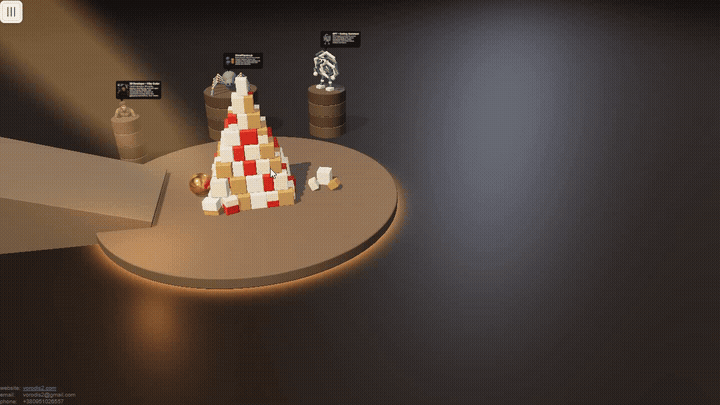
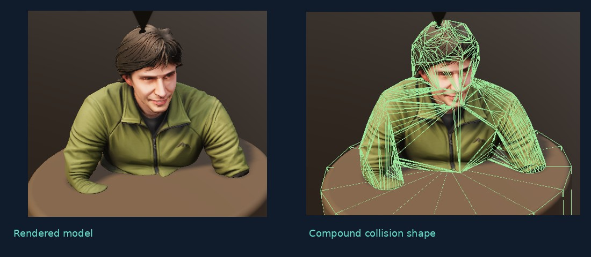

# Piramidka · AI + 3D Physics

An interactive browser physics playground, built with **Three.js**, **OimoPhysics**, and an AI-assisted development workflow.

**[Try the live demo](https://vorodis2.com/_pyramid/)** · **[Watch the 59-second devlog](docs/media/piramidka_devlog.mp4)** · **[About the developer](https://vorodis2.com/)**



Build a pyramid, change its layout, drag objects, and explore collisions between primitives and imported 3D models. This is an evolving personal project exploring how AI can support practical 3D development.

## Highlights

- **Interactive rigid-body physics:** stacked blocks, a rolling ball, object dragging, and selectable pyramid layouts.
- **Model collision shapes:** approximate imported geometry with a single convex hull, multiple convex parts, or a compound arrangement of boxes.
- **Physics debugging:** inspect collision shapes as wireframes alongside the rendered models.
- **Primitive characters:** a spider and a ChatGPT-logo-inspired character recreated from concept images using spheres, cylinders, and boxes.
- **Scene controls:** adjust the simulation through the on-screen interface; scene and UI settings are persisted locally.



The green wireframes show the collision approximation. Several convex shapes belong to one rigid body; this is an approximation of the model, not an exact triangle-mesh collider.

## Why I built it

I started with a simple idea: build a pyramid of boxes and knock it down with a ball. It became an experiment in combining my experience in 3D and physics with AI-assisted development.

I used AI to help implement controls, process 3D assets, recreate primitive characters from images, and develop geometry splitting for compound colliders. I also tried generated scenery and chess assets, then decided against using them in the scene.

My role is to define the behavior and constraints, guide the architecture, choose which results to use, and validate the implementation. My main takeaway: faster code generation makes understanding the code structure even more important.

## Run locally

Use **Node.js 22.12+** (or a supported newer release) and npm.

```bash
git clone https://github.com/vorodis2/pyramid.git
cd pyramid/www
npm ci
npm run dev
```

Open **http://localhost:5173/div.html** for the current scene. If Vite selects another port, use that port with `/div.html`.

The root Vite page (`/`) loads the earlier TypeScript/React prototype. The current scene uses the JavaScript entry point in `src/pirDiv/` and its own UI components.

### Build and preview

From `www`:

```bash
npm run build
npm run preview
```

The build uses `div.html` and emits `dist/index.html`. Copy the **entire contents of `www/dist`** to a static web host. Relative asset paths support deployment in a subdirectory. Use HTTP/HTTPS rather than opening the HTML via `file://`.

See [build notes](www/BUILD.md) for details.

### Existing physics checks

From `www`, run individual checks with Node.js:

```bash
node tests/convex-parts.mjs
node tests/model-physics.mjs
node tests/physics-loading-pause.mjs
```

Additional checks live in [`www/tests`](www/tests). These cover selected geometry and physics behavior; they do not replace browser testing.

## Source map

| Location | Purpose |
| --- | --- |
| [`www/div.html`](www/div.html) | Current development entry page; also the production build input |
| [`www/src/pirDiv`](www/src/pirDiv) | Current scene, controls, pyramid generation, objects, and interaction |
| [`www/src/physics/PhysicsWorld.js`](www/src/physics/PhysicsWorld.js) | Application-facing OimoPhysics integration and collision-shape creation |
| [`www/src/visi3D`](www/src/visi3D) | Rendering, camera, and interaction utilities |
| [`www/src/piramidka`](www/src/piramidka) | Earlier TypeScript/React prototype |
| [`www/tests`](www/tests) | Geometry, physics, loading, and lifecycle checks |

**Stack:** JavaScript, TypeScript, Three.js, OimoPhysics, and Vite. React is used in the earlier prototype, not the current scene's control panel.

## Status and limitations

Work in progress. Generated collision shapes approximate the source geometry; results depend on the model and chosen settings. Rendering and physics performance vary with the device and scene complexity. Dependencies include an OimoPhysics archive from its upstream `master` branch; see `www/package-lock.json` for the resolved installation.

## Developer & collaboration

**Yevhen Sidorov** — 3D developer with 10+ years of experience in interactive applications, configurators, physics, and simulations.

I'm open to **remote roles and project collaborations** involving Three.js / WebGL, interactive 3D tools, and simulation, with a practical AI-assisted workflow.

**[Portfolio & contact](https://vorodis2.com/)** · **[GitHub profile](https://github.com/vorodis2)**

## Third-party tools and assets

Built with [Three.js](https://github.com/mrdoob/three.js) and [OimoPhysics](https://github.com/saharan/OimoPhysics). AI-generated image and model experiments used ChatGPT and Hunyuan 3D. The ChatGPT-inspired character references the OpenAI/ChatGPT logo; this is an independent personal project.

No project-wide license has been selected yet. The presence of source code or assets in this repository does not grant a blanket reuse license; third-party components and assets retain their applicable terms.
